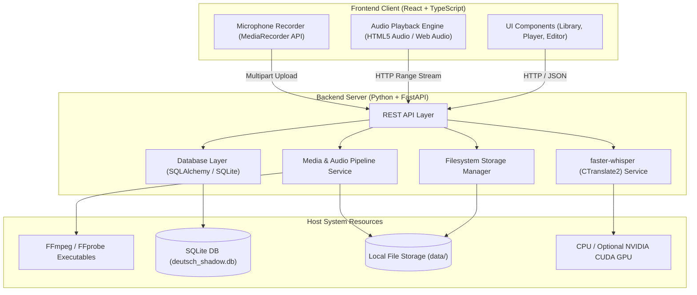
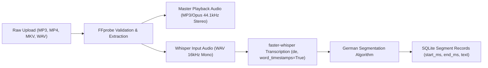
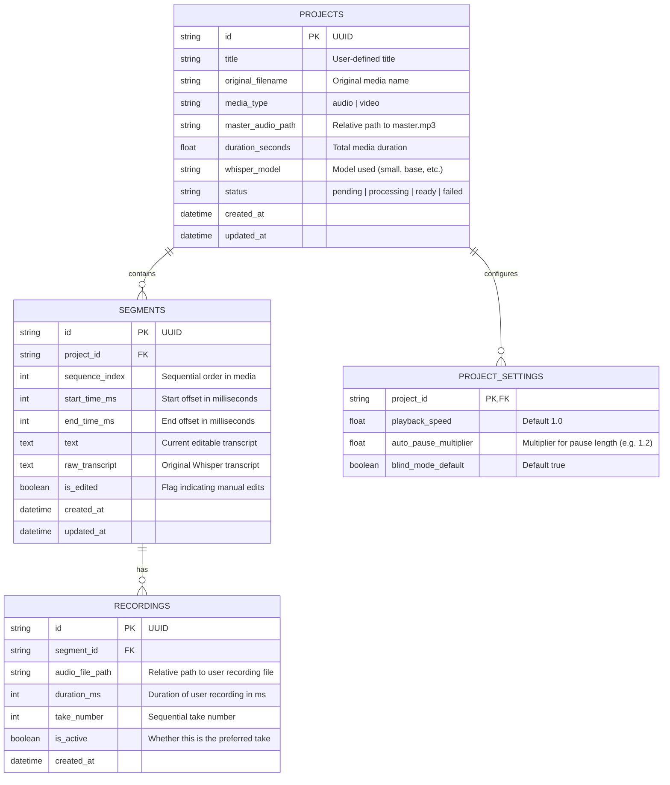

# Technical Design Document — Deutsch Shadow

**Version:** 1.0.0-MVP  
**Status:** In Review  
**Author:** AI Architecture Team  

---

## 1. System Architecture Overview

Deutsch Shadow adopts a local-first, decoupled client-server architecture:
- **Backend:** A lightweight Python (FastAPI) daemon running on `localhost:8000`, responsible for media conversion via FFmpeg, local speech-to-text inference via `faster-whisper`, database operations with SQLite, and local filesystem I/O.
- **Frontend:** A React 18+ Single Page Application (SPA) written in TypeScript and bundled via Vite, hosted locally (or served directly by FastAPI as static files in production mode), communicating with the backend over JSON REST endpoints and HTTP Range audio streams.
- **Media Engine & Storage:** Media resides directly in a structured local data directory (`data/projects/{project_id}/...`), indexed by SQLite.



---

## 2. Audio Processing Pipeline

The audio processing pipeline transforms raw user media into standardized, web-ready audio and time-stamped speech segments.



### 2.1 Media Ingestion & Standardization
1. **Validation & Metadata Probe:**
   - Execute `ffprobe -v quiet -print_format json -show_format -show_streams` to verify audio track presence, duration, sample rate, and codec.
2. **Master Playback File Generation:**
   - Command:
     ```bash
     ffmpeg -i input_file -vn -c:a libmp3lame -q:a 2 -ar 44100 master.mp3
     ```
   - MP3 at 44.1kHz with high variable bitrate is chosen for broad native HTML5 `<audio>` playback and universal range request seeking support without transcoding overhead.
3. **Inference File Generation:**
   - Faster-whisper operates natively on 16kHz mono PCM:
     ```bash
     ffmpeg -i master.mp3 -vn -acodec pcm_s16le -ac 1 -ar 16000 whisper_input.wav
     ```
   - This temporary file can be removed after transcription or retained in cache for debugging.

### 2.2 Local Speech Recognition Pipeline
- **Engine:** `faster-whisper` utilizing CTranslate2.
- **Parameters:**
  - `language="de"` (avoids language-detection hallucination and reduces initial latency).
  - `task="transcribe"`
  - `word_timestamps=True` (yields exact start and end offsets for every individual token/word).
  - `vad_filter=True` (Voice Activity Detection filter to strip leading/trailing silence and background noises).
- **Model Tiers & Hardware Adaptation:**
  - `base` (~140MB): Minimum viable footprint for low-end CPUs (4 cores).
  - `small` (~460MB, Recommended Default): Optimal balance of German grammatical accuracy, case handling, and CPU inference speed.
  - `medium` (~1.5GB): High accuracy for noisy audio; requires 8+ CPU cores or a dedicated CUDA GPU (4GB+ VRAM).

### 2.3 German Syntax & Punctuation Segmentation Algorithm
Whisper raw segments are often either too long (entire paragraphs) or arbitrarily chopped at 30-second token windows. The segmentation engine (`GermanSegmenter`) reorganizes word-level timestamps into ideal shadowing units:

1. **Target Segment Constraints:**
   - Ideal duration: **2.5 to 4.5 seconds** (`target_duration_s = 4.0`).
   - Maximum segment duration: **7.0 seconds** (`max_duration_s = 7.0`).
   - Minimum segment duration: **1.2 seconds** (`min_duration_s = 1.2`).
2. **Splitting Rules (in priority order):**
   - **Terminal Sentence Punctuation:** Split on `.`, `!`, `?` and German closing quotes (`“`, `”`, `»`, `«`).
   - **Abbreviation Guard:** Filter out known German abbreviations (`z. B.`, `bzw.`, `ca.`, `d. h.`, `u. a.`, `usw.`, `Dr.`, `Prof.`) and single-letter initials to prevent false splits.
   - **Long Acoustic Pauses:** Split when a gap between consecutive words is $\ge 600\text{ms}$ (`pause_split_threshold_s = 0.6`).
   - **Clause Punctuation (Subordinate clauses):** If accumulated duration reaches $\ge 4.0\text{s}$, split on clause punctuation (`,`, `;`, `:`, `—`).
   - **Hard Overflow Protection:** If a continuous run of speech has no punctuation and reaches 7.0 seconds, force a split at the word boundary.
3. **Acoustic Padding & Alignment:**
   - Add $+80\text{ms}$ lead-in padding to preserve initial plosives and glottal stops (*Knacklaute*).
   - Add $+80\text{ms}$ tail-out padding to avoid truncating unstressed German endings (e.g. *-en*, *-er*, *-t*).
   - Enforce strictly non-overlapping boundaries (`padded_start_ms >= last_end_ms`).
   - Strictly enforce playable duration limit: final playable duration (`end_ms - start_ms`) cannot exceed `max_duration_s` ($7,000\text{ms}$). If raw speech and padding together exceed this ceiling, excess padding is trimmed and chunks split prior to overflow.
   - Clamp final playable segment end boundary to exact media duration (`end_ms <= media_duration_ms`).
   - Merge orphan trailing fragments shorter than `min_duration_s` into previous segment only if the combined duration remains within limits.

---

## 3. Non-Destructive Segment Playback

A foundational principle of Deutsch Shadow is **zero per-segment audio file generation**:
- Generating hundreds of 3-second audio slices wastes disk space, exhausts file descriptors, and creates messy synchronization state.
- Instead, the browser plays segments directly from `master.mp3`.

### 3.1 Backend Streaming via HTTP Range Requests
FastAPI serves the master file using standard byte-range responses (`Status 206 Partial Content`):
```python
@router.get("/media/{project_id}/master.mp3")
async def stream_master_audio(project_id: str, request: Request):
    file_path = get_project_master_path(project_id)
    return range_requests_response(file_path, request)
```

### 3.2 Frontend Playback Engine Synchronization
- The HTML5 Audio element loads `master.mp3`.
- When segment $k$ is played:
  1. The player sets `audio.currentTime = segment.start_time_ms / 1000.0`.
  2. `audio.play()` is invoked.
  3. A high-frequency animation frame (`requestAnimationFrame`) or `timeupdate` listener checks if `audio.currentTime >= segment.end_time_ms / 1000.0`.
  4. Upon reaching the end boundary:
     - If **Single Play**, pause immediately.
     - If **Loop Mode**, reset `currentTime` to `start_time_ms / 1000.0` and continue playing.
     - If **Auto-Pause Mode**, pause, start countdown timer, then resume or record.

---

## 4. Database Schema (SQLite)



### Table Definitions & Indexes
- `projects.id`: Indexed primary key.
- `segments.project_id`, `segments.sequence_index`: Compound index on `(project_id, sequence_index)` for fast, ordered segment retrieval.
- `recordings.segment_id`: Indexed foreign key.

---

## 5. API Design & Endpoints

All endpoints use standard JSON payloads and HTTP status codes.

### 5.1 Project Endpoints
- `GET /api/projects`: List all projects with metadata and segment counts.
- `POST /api/projects/import`: Multipart form upload (media file + optional title). Returns `project_id` and triggers background processing task.
- `GET /api/projects/{id}`: Retrieve project detail and current processing status (`pending`, `processing`, `ready`, `error`).
- `DELETE /api/projects/{id}`: Delete project, its database records, and associated files on disk.

### 5.2 Segment Endpoints
- `GET /api/projects/{id}/segments`: Retrieve all segments for a project, sorted by `sequence_index`.
- `PATCH /api/segments/{id}`: Update segment text or adjust `start_time_ms` / `end_time_ms`.
  - Body: `{ "text"?: string, "start_time_ms"?: int, "end_time_ms"?: int }`
- `POST /api/segments/{id}/split`: Split segment into two at specified millisecond timestamp or character index.
- `POST /api/segments/{id}/merge`: Merge segment with adjacent segment (`direction`: `"next"` or `"previous"`).

### 5.3 Recording & Media Endpoints
- `GET /api/media/{project_id}/master`: HTTP 206 Partial Content audio stream of the project's master audio.
- `POST /api/segments/{id}/recordings`: Multipart upload of the user's audio take (WAV/WebM).
- `GET /api/recordings/{id}/audio`: Stream user recorded audio file.
- `DELETE /api/recordings/{id}`: Delete an individual take.

### 5.4 System & Hardware Endpoints
- `GET /api/system/capabilities`:
  - Returns hardware audit: CPU physical/logical cores, total RAM, NVIDIA CUDA availability, detected FFmpeg binary path, and recommended default Whisper model.
- `GET /api/system/models`:
  - Returns downloaded vs. available Whisper model tiers.

---

## 6. Frontend Architecture (React + TypeScript)

### 6.1 State Management & Architecture
- **Router:** React Router or lightweight view switcher (`LibraryView`, `PlayerView`, `SettingsModal`).
- **Store / Context:** 
  - `ProjectContext`: Active project metadata, segment list, selection index.
  - `PlaybackContext`: Audio element reference, play/pause state, current millisecond playhead, loop mode, speed, transcript visibility (`blind` vs `revealed`).
  - `RecordingContext`: MediaRecorder status (idle, recording, paused), recorded takes cache, active take selection.

### 6.2 Key Hooks
- `useMasterAudio(masterAudioUrl)`: Encapsulates `<audio>` element management, seek execution, boundary clamping via `requestAnimationFrame`, and HTTP range streaming error handling.
- `useVoiceRecorder(segmentId)`: Handles `navigator.mediaDevices.getUserMedia`, microphone stream routing, blob creation, take numbering, and backend upload.
- `useABComparison(masterAudioUrl, userAudioUrl)`: Orchestrates one-click toggle or sequential playback:
  - Sequence: `Play Master [start..end] -> Silence Gap (250ms) -> Play User Recording -> Stop`.

### 6.3 Keyboard Shortcuts (Ergonomic Shadowing Controls)
| Key | Action |
|---|---|
| `Space` | Play / Pause current segment |
| `R` | Toggle transcript visibility (Blind / Reveal) |
| `Left Arrow` | Previous segment |
| `Right Arrow` | Next segment |
| `L` | Toggle segment loop mode |
| `M` | Push-to-talk / Toggle microphone recording |
| `C` | One-click A/B compare (Original vs. User) |
| `[` / `]` | Nudge segment start boundary (-50ms / +50ms) |
| `{` / `}` | Nudge segment end boundary (-50ms / +50ms) |

---

## 7. Decoupling Strategy for Future Mobile Application

To ensure future mobile clients (e.g. React Native or Swift/Kotlin) can reuse the identical backend without refactoring:
1. **Zero Server-Side Rendering (SSR):** Backend renders no HTML or UI templates.
2. **Standard REST & Streaming:** All audio transport relies on standard HTTP 206 byte-ranges, which native mobile media players (`AVPlayer` on iOS, `ExoPlayer` on Android) consume natively.
3. **Stateless Operations:** API endpoints do not rely on server session cookies.
4. **Client-Agnostic Storage Layout:** Filesystem directory layout is strictly internal to the server and exposed only via resource URIs (`/api/media/...`).

---

## 8. Hardware Validation & Fallback Strategy

The application must run reliably on heterogeneous user hardware:

1. **Hardware Detection Routine on Backend Startup:**
   ```python
   def detect_hardware():
       cuda_available = torch.cuda.is_available() if torch_installed else False
       cpu_count = os.cpu_count() or 4
       # Recommend configuration
       if cuda_available and torch.cuda.get_device_properties(0).total_memory > 4e9:
           return {"device": "cuda", "compute_type": "float16", "recommended_model": "small"}
       else:
           return {"device": "cpu", "compute_type": "int8", "recommended_model": "small" if cpu_count >= 8 else "base"}
   ```
2. **Quantization:** On CPU, always force `compute_type="int8"` to reduce memory bandwidth demands and improve throughput by ~2.5x compared to `float32`.
3. **FFmpeg Discovery:** Backend checks for `ffmpeg` on system `PATH`. If missing, inspects local directory or provides clear user guidance.
